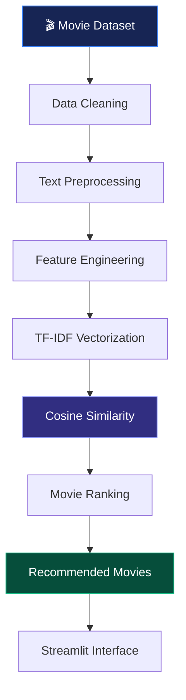

# 🎬 Movie Recommendation System

<p align="center">
  <strong>Discover movies you'll love.</strong>
  <br/>
  An intelligent content-based movie recommendation engine powered by Machine Learning and Natural Language Processing.
  <br/><br/>
  <a href="YOUR_FRONTEND_DEPLOYMENT_URL">🌐 Live Demo</a> •
  <a href="YOUR_BACKEND_DEPLOYMENT_URL/docs">📖 API Documentation</a> •
  <a href="https://github.com/gursimranai/Movie-Recommendation-System">⭐ GitHub Repository</a>
</p>

<p align="center">
  
  
  
  
  
</p>

---

## 🍿 Overview

Finding your next favorite movie shouldn't be difficult.

**Movie Recommendation System** is a machine-learning project that analyzes movie metadata and recommends similar movies using content-based filtering.

By combining Natural Language Processing, TF-IDF vectorization, and Cosine Similarity, the system identifies relationships between movies and generates recommendations based on their content.

The project also integrates a FastAPI backend and an interactive Streamlit frontend, bringing the recommendation engine into a deployable web application.

---

## 🌐 Live Application

<p align="center">
  <a href="YOUR_FRONTEND_DEPLOYMENT_URL">
    
  </a>
</p>

| Service | Link |
|:---|:---|
| 🌐 Web Application | [Open Application](YOUR_FRONTEND_DEPLOYMENT_URL) |
| ⚡ Backend API | [API Endpoint](YOUR_BACKEND_DEPLOYMENT_URL) |
| 📚 API Documentation | [FastAPI Swagger UI](YOUR_BACKEND_DEPLOYMENT_URL/docs) |

---

## ✨ Key Features

| Feature | Description |
|:---|:---|
| 🎯 Content-Based Filtering | Recommends movies based on their content and metadata. |
| 🧠 NLP Processing | Processes movie descriptions and related textual information. |
| 🔢 TF-IDF Vectorization | Converts movie text into numerical feature vectors. |
| 📐 Cosine Similarity | Measures similarity between movie representations. |
| ⚡ FastAPI Backend | Provides recommendation functionality through REST APIs. |
| 🎨 Streamlit Interface | Provides an interactive movie discovery experience. |
| 🎬 Movie Discovery | Helps users explore movies related to their selections. |
| ☁️ Deployment | Makes the application accessible through a hosted interface. |

---

## 🧠 Recommendation Engine

The recommendation engine follows a content-based filtering approach.

### How does it work?



### Processing Steps

1. **Data Preparation** – Load movie datasets and relevant metadata.
2. **Data Cleaning** – Handle missing values, duplicate records, and inconsistent information.
3. **Feature Engineering** – Combine relevant attributes such as genres, keywords, cast, crew, and movie overview.
4. **Text Vectorization** – Apply TF-IDF to transform textual features into numerical representations.
5. **Similarity Calculation** – Calculate cosine similarity between movie vectors.
6. **Recommendation Generation** – Rank movies according to their similarity scores.
7. **API Integration** – Serve recommendations through FastAPI.
8. **Frontend Display** – Present movie recommendations through Streamlit.

---

## 🛠️ Technology Stack

<p align="center">
  
</p>

| Category | Technologies |
|:---|:---|
| Language | Python |
| Data Processing | Pandas, NumPy |
| Machine Learning | Scikit-learn |
| Natural Language Processing | Text Preprocessing, TF-IDF |
| Similarity Measurement | Cosine Similarity |
| Backend | FastAPI |
| Frontend | Streamlit |
| Movie Data | TMDB, MovieLens |
| Model Serialization | Pickle |
| Version Control | Git, GitHub |
| Deployment | Cloud Hosting |

---

## 📂 Project Structure

```text
Movie-Recommendation-System/
│
├── data/
│   ├── raw/
│   └── processed/
│
├── notebooks/
│   └── model_experimentation.ipynb
│
├── models/
│
├── src/
│   └── recommender/
│
├── app/
│   ├── frontend/
│   └── backend/
│
├── tests/
│
├── requirements.txt
├── .gitignore
├── LICENSE
└── README.md
```

*The structure shown is illustrative; refer to the actual repository for the current implementation.*

---

## 🚀 Getting Started

Want to run the project locally? Follow these steps.

### Prerequisites

- Python 3.10 or newer
- Git
- pip

### 1. Clone the Repository

```bash
git clone https://github.com/gursimranai/Movie-Recommendation-System.git
cd Movie-Recommendation-System
```

### 2. Create a Virtual Environment

```bash
python -m venv .venv
```

Activate on Windows:

```powershell
.venv\Scripts\activate
```

Activate on macOS/Linux:

```bash
source .venv/bin/activate
```

### 3. Install Dependencies

```bash
pip install -r requirements.txt
```

### 4. Configure Environment Variables

If your implementation uses TMDB API credentials, create a `.env` file:

```env
TMDB_API_KEY=your_api_key
```

Keep credentials private and never commit your `.env` file.

### 5. Start the Backend

```bash
uvicorn app.backend.main:app --reload
```

### 6. Start the Frontend

Open another terminal:

```bash
streamlit run app.frontend.streamlit_app
```

*Update the module paths and commands according to the actual application entry points.*

---

## 📊 Datasets

The project uses movie metadata for developing and experimenting with recommendation algorithms.

Potential datasets used in the project:

- **TMDB 5000 Movies Dataset**
- **TMDB 5000 Credits Dataset**
- **MovieLens Latest Small Dataset**

### Dataset Resources

- [TMDB Movie Metadata – Kaggle](https://www.kaggle.com/datasets/tmdb/tmdb-movie-metadata)
- [MovieLens – GroupLens](https://grouplens.org/datasets/movielens/)

---

## 🖼️ Screenshots

<p align="center">
  <i>Application screenshots coming soon.</i>
</p>

<!-- Replace the placeholders with actual screenshots from your application.

<p align="center">
  
  <br/>
  <em>Movie Recommendation System — Homepage</em>
</p>

<p align="center">
  
  <br/>
  <em>Recommended Movies</em>
</p>
-->

---

## 🔨 Development & Improvements

This project was initially developed with guidance from an educational tutorial and has been extended through additional implementation, experimentation, and improvements.

The development process focuses on:

- Understanding and implementing recommendation algorithms.
- Improving code organization and modularity.
- Separating machine-learning functionality from backend services.
- Enhancing the application interface.
- Improving reliability and error handling.
- Making the application deployable and accessible.

---

## 🗺️ Future Roadmap

The following are potential improvements for future development:

- [ ] Improve recommendation relevance and ranking.
- [ ] Add collaborative filtering.
- [ ] Explore hybrid recommendation algorithms.
- [ ] Introduce personalized movie recommendations.
- [ ] Improve movie search and filtering.
- [ ] Expand automated testing.
- [ ] Optimize recommendation performance.
- [ ] Enhance frontend responsiveness.

---

## 🙏 Acknowledgements & Learning Resources

This project was developed with guidance from educational tutorials, followed by independent experimentation, modifications, and additional improvements.

### 🎓 Tutorial References

**1. Sheryians AI School — End-to-End Movie Recommendation System using NLP and FastAPI**

[▶ Watch Tutorial](https://www.youtube.com/watch?v=IoL9FzHvL3I&t=5240s)

Provided guidance on building a content-based recommendation system, NLP preprocessing, TF-IDF, cosine similarity, and FastAPI integration.

**2. CampusX — Movie Recommendation System**

[▶ Watch Tutorial](https://youtu.be/1xtrIEwY_zY?si=Nsf-Y0Fw7BkZeN_Z)

Provided additional learning resources and insights into movie recommendation techniques and their implementation.

### 💡 Project Development

Both resources contributed to my learning and understanding of recommendation systems. The project has been further developed through my own implementation, experimentation, modifications, and deployment efforts.

Full credit to the original creators for their educational content and guidance.

---

## 👨‍💻 Author

<p align="center">
  <strong>Gursimran Singh</strong>
  <br/>
  Computer Science Undergraduate | AI & ML Enthusiast
  <br/><br/>
  <a href="https://github.com/gursimranai">
    
  </a>
  <a href="https://www.linkedin.com/in/gursimranai/">
    
  </a>
</p>

---

## 📄 License

This project is licensed under the MIT License. See the [LICENSE](LICENSE) file for details.

---

<p align="center">
  <strong>⭐ If you find this project interesting, consider giving it a star!</strong>
  <br/>
  Built with Python, Machine Learning, and curiosity. 🍿
</p>