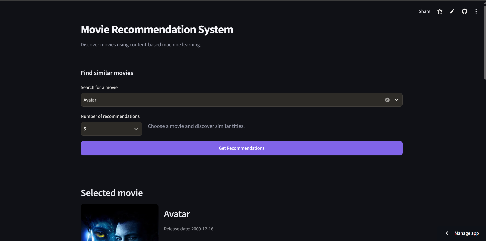
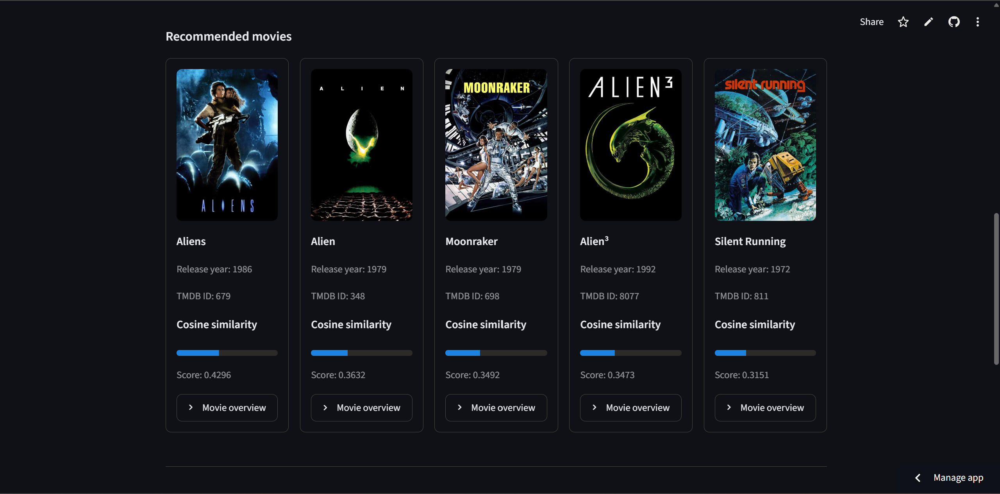
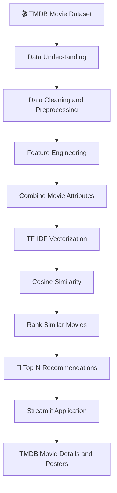

# 🎬 Movie Recommendation System

<p align="center">
  <strong>Discover movies similar to the ones you love.</strong>
  <br />
  A content-based movie recommendation system built using Python, Natural Language Processing, TF-IDF, and Cosine Similarity.
  <br /><br />
  <a href="https://content-based-movie-recommendation-system-rqy8ony5ukzrbca8xksk.streamlit.app/">
    🌐 Live Application
  </a>
  •
  <a href="https://github.com/gursimranai/Movie-Recommendation-System">
    ⭐ GitHub Repository
  </a>
</p>

<p align="center">
  
  
  
  
  
</p>

---

## 🍿 Overview

Finding your next favorite movie shouldn't be difficult.

**Movie Recommendation System** is a machine-learning project that recommends movies based on their content and metadata.

It uses a content-based filtering approach to identify similarities between movies. Movie attributes are combined into textual features, transformed into numerical representations using TF-IDF, and compared using Cosine Similarity.

The application provides an interactive Streamlit interface where users can search for a movie, select the number of recommendations, and discover similar titles.

Movie information and posters are retrieved using the TMDB API.

## 🌐 Live Application

<p align="center">
  <a href="https://content-based-movie-recommendation-system-rqy8ony5ukzrbca8xksk.streamlit.app/">
    
  </a>
</p>

**[Open Movie Recommendation System](https://content-based-movie-recommendation-system-rqy8ony5ukzrbca8xksk.streamlit.app/)**

The application is deployed using Streamlit Community Cloud.

---

## 🖼️ Application Screenshots

### Movie Search and Selection

Users can search for a movie and select how many recommendations they want.



### Movie Recommendations

The system displays similar movies with their posters, release years, TMDB IDs, cosine similarity scores, and links to movie overviews.



---

## ✨ Features

| Feature | Description |
|---|---|
| 🎯 Content-Based Filtering | Recommends movies based on their content and metadata. |
| 🔎 Movie Search | Search and select movies from the available dataset. |
| 🔢 TF-IDF Vectorization | Converts textual movie features into numerical vectors. |
| 📐 Cosine Similarity | Measures similarity between movie representations. |
| 🎬 Movie Recommendations | Returns the most similar movies for a selected title. |
| 🎨 Streamlit Interface | Interactive web application with a custom-styled interface. |
| 🖼️ Movie Posters | Retrieves movie posters and details through the TMDB API. |
| ⚙️ Configurable Results | Choose between 5, 10, 15, and 20 recommendations. |
| 🧪 Automated Testing | Tests the recommendation engine, application, TMDB service, and training script. |
| ☁️ Cloud Deployment | Accessible through Streamlit Community Cloud. |

---

## 🧠 How the Recommendation System Works

This project uses **Content-Based Filtering**.

Instead of recommending movies based on what other users watched, the system analyzes movie attributes and identifies titles with similar content.

### Recommendation Pipeline



### Processing Steps

1. **Data Understanding** – Explore the movie datasets and understand their columns, distributions, and relationships.
2. **Data Preprocessing** – Handle missing values, parse metadata, and prepare the movie information.
3. **Feature Engineering** – Combine relevant movie attributes, including genres, keywords, cast, crew, and overview, into textual features.
4. **TF-IDF Vectorization** – Transform the combined textual features into numerical vectors.
5. **Cosine Similarity** – Compare movie vectors to measure how similar their content is.
6. **Recommendation Generation** – Rank movies by similarity and return the requested number of results.
7. **Application Integration** – Display recommendations through the Streamlit interface.

### Recommendation Example

For the selected movie **Avatar**, the application returns similar titles such as:

| Recommended Movie | Release Year |
|---|---:|
| Aliens | 1986 |
| Alien | 1979 |
| Moonraker | 1979 |
| Alien³ | 1992 |
| Silent Running | 1972 |

The application also displays the corresponding cosine similarity scores.

---

## 🛠️ Technology Stack

| Category | Technologies |
|---|---|
| Programming Language | Python |
| Data Processing | Pandas, NumPy |
| Machine Learning | Scikit-learn |
| Natural Language Processing | Text Preprocessing, TF-IDF |
| Similarity Measurement | Cosine Similarity |
| Sparse Matrix Processing | SciPy |
| Model Serialization | Joblib |
| Frontend and Application | Streamlit |
| External Movie Data | TMDB API |
| Testing | Pytest |
| Code Quality | Ruff |
| Version Control | Git, GitHub |
| Deployment | Streamlit Community Cloud |

---

## 📂 Project Structure

```text
Movie-Recommendation-System/
│
├── app/
│   ├── components/
│   │   ├── movie_card.py
│   │   └── search.py
│   │
│   ├── services/
│   │   └── tmdb.py
│   │
│   ├── styles/
│   │   └── main.css
│   │
│   └── streamlit_app.py
│
├── data/
│   ├── raw/
│   │   ├── tmdb_5000_credits.csv
│   │   ├── tmdb_5000_movies.csv
│   │   └── README.md
│   │
│   ├── interim/
│   └── processed/
│
├── models/
│   ├── movies_metadata.joblib
│   └── tfidf_matrix.joblib
│
├── notebooks/
│   ├── 01-data-understanding.ipynb
│   ├── 02_exploratory_data_analysis.ipynb
│   ├── 03_data_preprocessing.ipynb
│   ├── 04_feature_engineering.ipynb
│   ├── 05_content_based_recommendation.ipynb
│   └── 06_model_evaluation.ipynb
│
├── scripts/
│   └── train_model.py
│
├── src/
│   └── movie_recommender/
│       ├── __init__.py
│       ├── config.py
│       └── recommender.py
│
├── tests/
│   ├── test_recommender.py
│   ├── test_streamlit_app.py
│   ├── test_tmdb.py
│   └── test_train_model.py
│
├── .env.example
├── .gitignore
├── pyproject.toml
├── requirements.txt
├── requirements-dev.txt
└── README.md
```

*Generated datasets and unused model artifacts are excluded from version control.*

---

## 🚀 Getting Started

Follow these steps to run the project locally.

### Prerequisites

- Python 3.10 or newer
- Git
- pip

### 1. Clone the Repository

```bash
git clone https://github.com/gursimranai/Movie-Recommendation-System.git

cd Movie-Recommendation-System
```

### 2. Create a Virtual Environment

```bash
python -m venv .venv
```

Activate the environment on Windows:

```powershell
.venv\Scripts\activate
```

Activate on macOS/Linux:

```bash
source .venv/bin/activate
```

### 3. Install Dependencies

```bash
python -m pip install --upgrade pip

pip install -r requirements.txt
```

### 4. Configure TMDB API Key (Optional)

The application can generate recommendations without a TMDB API key. However, movie posters and additional movie details require TMDB access.

Create a `.env` file in the project root:

```env
TMDB_API_KEY=your_tmdb_api_key
```

Never commit your actual API key or `.env` file.

### 5. Run the Application

```bash
streamlit run app/streamlit_app.py
```

The application will open in your browser.

---

## 📊 Dataset

This project uses the TMDB 5000 movie metadata datasets.

| Dataset | Description |
|---|---|
| TMDB 5000 Movies | Movie information, genres, keywords, overview, and other metadata. |
| TMDB 5000 Credits | Cast and crew information associated with movies. |

### Dataset Resources

- [TMDB 5000 Movie Dataset – Kaggle](https://www.kaggle.com/datasets/tmdb/tmdb-movie-metadata)
- [TMDB API Documentation](https://developer.themoviedb.org/docs)

The raw CSV files are not included in the Git repository. Refer to `data/raw/README.md` for dataset information.

---

## 🧪 Testing and Code Quality

The project includes automated tests for the core recommendation engine, Streamlit application, TMDB service, and model training functionality.

Run the test suite:

```bash
python -m pytest -v
```

Check code quality with Ruff:

```bash
python -m ruff check .
```

Check formatting:

```bash
python -m ruff format --check .
```

### Current Verification

| Verification | Result |
|---|---|
| Automated tests | 44 passed |
| Ruff linting | Passed |
| Ruff formatting | Passed |
| Model artifact loading | Passed |
| Movies in recommendation model | 4,803 |

*These results reflect the local verification performed during deployment preparation.*

---

## 🔨 Development and Learning

This project was initially developed with guidance from educational tutorials and further extended through implementation, experimentation, and improvements.

The development work focused on:

- Understanding content-based recommendation algorithms.
- Exploring and preprocessing movie metadata.
- Building a TF-IDF-based recommendation engine.
- Implementing cosine similarity for movie ranking.
- Organizing code into reusable Python modules.
- Integrating an external movie information API.
- Building an interactive Streamlit application.
- Writing automated tests and improving code quality.
- Deploying the application to the cloud.

---

## 🙏 Acknowledgements and Learning Resources

This project was developed as a learning exercise, using educational resources as guidance, followed by additional implementation and experimentation.

### 1. Sheryians AI School

**End-to-End Movie Recommendation System using NLP and FastAPI**

[▶ Watch Tutorial](https://www.youtube.com/watch?v=IoL9FzHvL3I&t=5240s)

An educational reference for understanding movie recommendation systems, text preprocessing, TF-IDF, cosine similarity, and application development.

### 2. CampusX

**Movie Recommendation System**

[▶ Watch Tutorial](https://youtu.be/1xtrIEwY_zY?si=Nsf-Y0Fw7BkZeN_Z)

An additional learning resource for understanding content-based recommendation techniques and their implementation.

Full credit to the original creators for their educational content and guidance.

---

## 👨‍💻 Author

**Gursimran Singh**

Computer Science Undergraduate | AI & ML Enthusiast

<p align="center">
  <a href="https://github.com/gursimranai">
    
  </a>
  <a href="https://www.linkedin.com/in/gursimranai/">
    
  </a>
</p>

---

<p align="center">
  <strong>⭐ If you find this project interesting, consider giving it a star!</strong>
  <br />
  Built with Python, Machine Learning, and curiosity. 🍿
</p>